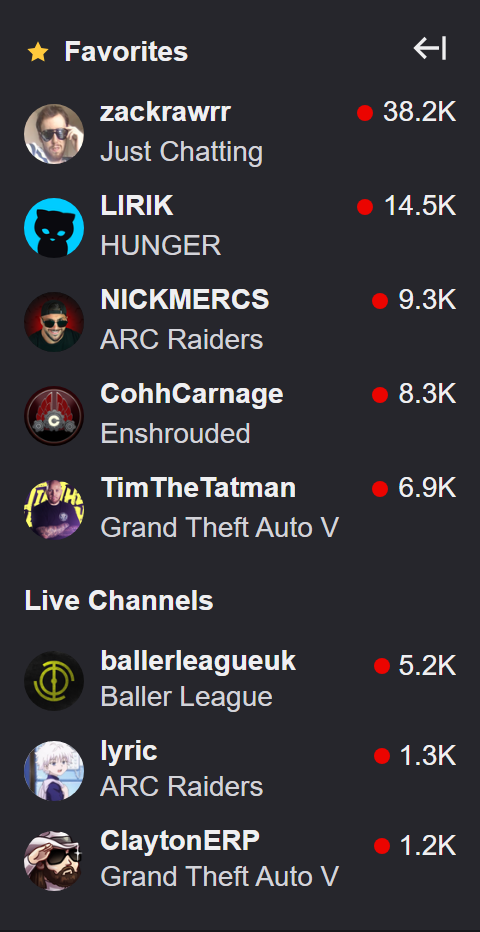
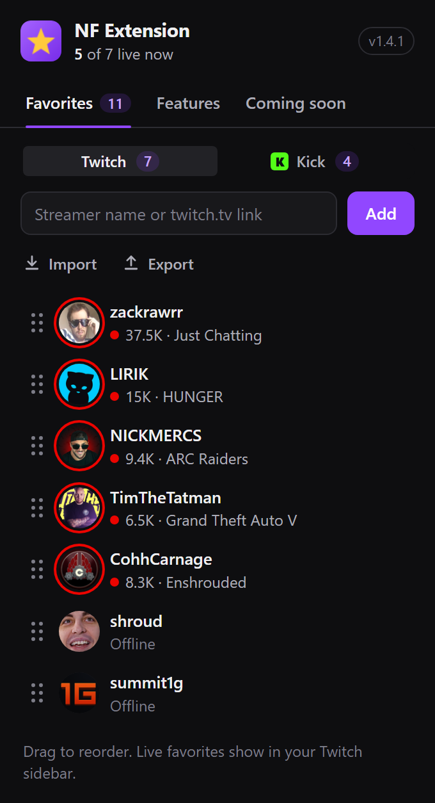
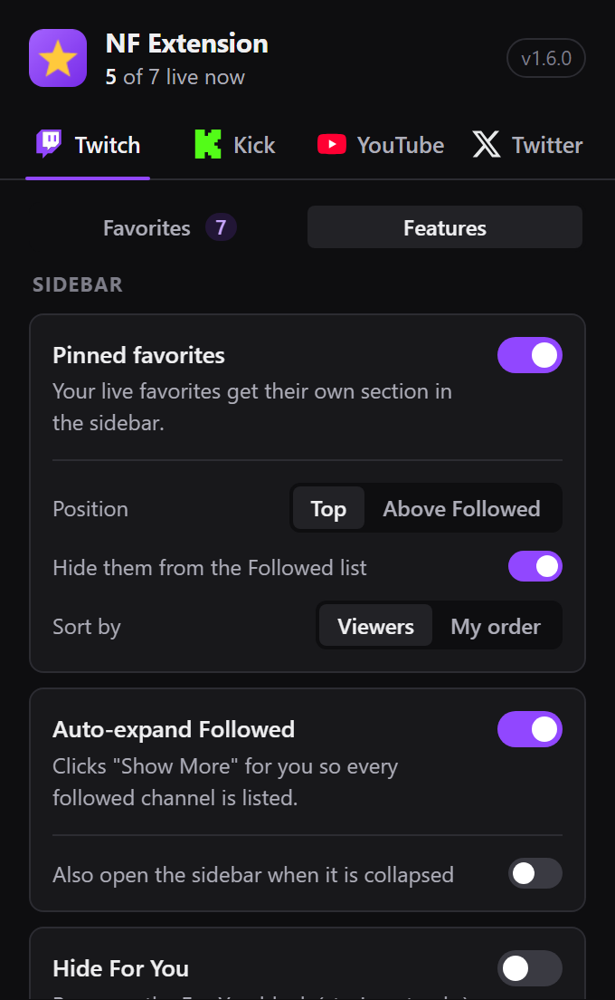
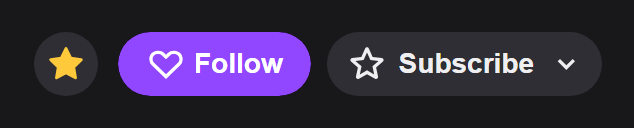

<p align="center">
  
</p>

<h1 align="center">NF Extension</h1>

<p align="center">
  Pin your favorite Twitch, Kick and YouTube streamers to the top of Twitch's sidebar, plus optional tweaks for Twitch, Kick, YouTube and X.
</p>

<p align="center">
  
  
  
  
</p>

---

NF Extension is a lightweight browser extension, built around [twitch.tv](https://www.twitch.tv). It keeps the streamers you care about in their own **★ Favorites** section of Twitch's sidebar, shows which of your **Kick** and **YouTube** channels are live right below it, and adds a set of optional quality-of-life tweaks for Twitch's sidebar, player and chat. It also has optional features for [kick.com](https://kick.com), [YouTube](https://www.youtube.com) and [X](https://x.com), all off until you turn them on.

Everything is controlled from the toolbar popup, which has a tab for each site. Changes apply to open tabs instantly, without a reload.

<table align="center">
  <tr>
    <td align="center"></td>
    <td align="center"></td>
    <td align="center"></td>
  </tr>
  <tr>
    <td align="center"><sub>★ Favorites and Kick in the sidebar</sub></td>
    <td align="center"><sub>Manage favorites in the popup</sub></td>
    <td align="center"><sub>Turn features on and off</sub></td>
  </tr>
</table>

## Features

Features are listed by site, the same way the popup's tabs show them.

### Twitch

#### Sidebar

| Feature | What it does | Default |
|---|---|---|
| **Pinned favorites** | A ★ Favorites section listing your favorites who are live right now, either at the top of the sidebar or just above Followed Channels. Sorted by viewers or by your own order, and optionally hidden from the Followed list so they don't show twice. Click the header to fold the section; it shows how many are live while folded. | On (Top, by viewers) |
| **Auto-expand Followed** | Clicks "Show More" until every followed channel is listed. It can also open the sidebar when it starts collapsed. | On |
| **Stream preview** | Rest the pointer on a live channel in the sidebar (★ Favorites, Kick, Followed or Live Channels) to see its live thumbnail, title, game and viewers. | Off |
| **Hide For You** | Removes the For You block (stories, streaks) above your Followed list. | Off |
| **Hide sidebar clutter** | Separate switches for sponsored cards in Followed, Live Channels, Viewers Also Watch and Recommended Categories. | Off |
| **Import from Followed** | A **From Followed** button on the popup's Favorites list: tick channels you follow on Twitch (with a filter and an All box) and pin them in one go. Needs you logged in to twitch.tv in this browser. | Off |

#### Channel & player

| Feature | What it does | Default |
|---|---|---|
| **Star button** | A ★ next to Follow on channel pages pins or unpins that streamer. | On |
| **Scroll volume** | The mouse wheel over the player changes the volume, from 1% to 20% per step, also over Twitch extensions shown on the video (lists inside them still scroll). Twitch remembers the volume as if you had used its own slider. | On (1%) |
| **Auto quality** | Every channel starts at Source, 1080p, 720p or 480p, or the closest quality below. | Off |
| **Auto theater mode** | Switches to theater mode when you open a channel. | Off |
| **Shortcuts & screenshot** | Keyboard shortcuts (below) plus full-resolution PNG screenshots of the stream, with a camera button in the player controls. | Off |
| **DVR (rewind live streams)** | A seek bar over the whole broadcast on live channels, with the time on the left and LIVE on the right. Drag or click back to any moment, or use <kbd>←</kbd> / <kbd>→</kbd> (10 seconds), and it plays from there in the same player, with live chat still beside it. LIVE catches up again. It plays Twitch's own recording of the broadcast, so the channel has to keep past broadcasts. | Off |
| **Audio compressor** | A button in the player that evens out loud and quiet moments, so one volume works for the whole stream. Click it to turn it on or off; your choice is remembered. | Off |
| **Volume boost** | A button in the player that makes quiet streams louder than 100%, by 125% to 300% (you pick). It works together with the Audio compressor, and the button's state is remembered. | Off (150%) |
| **Picture-in-picture button** | A button in the player that pops the stream out into a small window that stays on top of your other tabs and apps. | Off |
| **Catch up to live** | When a live stream falls behind after buffering, it jumps back to live instead of playing on behind; if it's still more than 3, 5 or 10 seconds behind (you pick) with enough video downloaded, it skips ahead. Twitch doesn't let live streams play faster, so it skips instead. | Off (5 s) |
| **Fullscreen chat** | While the player is fullscreen, chat shows over the right side of the video, see-through, and you can still read, scroll and type. | Off |
| **Auto refresh on player errors** | Reloads the page by itself when the player stops with error #1000, #2000, #3000, #4000 or #5000. It stops after a few tries in a row. | Off |
| **Stop front-page autoplay** | The featured stream at the top of Twitch's home page stays paused until you press play. | Off |

<p align="center">
  <br>
  <sub>The ★ button next to Follow: gold means the streamer is pinned.</sub>
</p>

#### Chat

| Feature | What it does | Default |
|---|---|---|
| **Auto-claim bonus points** | Clicks the channel points bonus chest for you while you watch. | Off |
| **Cleaner chat** | Separate switches to hide badges, Bits (cheer emotes, leaderboard, button) and the banners on top of chat (hype train, predictions), plus compact line spacing. | Off |
| **Highlight favorites in chat** | Messages from your favorite streamers get a gold mark in any chat. | Off |
| **Chat filter** | Hides chat messages that contain words you list, and highlights messages with other words you list. Separate words or phrases with commas; emote names count too. | Off |
| **Chat width** | Drag chat's left edge to make it wider or narrower, and the width is remembered. Double-click the edge for Twitch's own width. | Off |

### Kick

| Feature | What it does | Default |
|---|---|---|
| **Kick channels** | A Kick section under Favorites in Twitch's sidebar, listing the Kick channels that are live right now: the ones you add in the popup, plus the ones you follow on Kick while you're logged in to kick.com. Clicking one opens it on kick.com in a new tab. Foldable like Favorites. | Off |
| **Scroll volume** | On kick.com, the mouse wheel over the player changes the volume, from 1% to 20% per step. Kick's slider follows and Kick remembers the volume. | Off (1%) |
| **Favorites on kick.com** | Your live Kick channels (the Channels list in the popup's Kick tab) get their own section above Following in kick.com's sidebar, drawn like Kick's own rows. Optionally hides them from the Following list. | Off |
| **Star button** | A ★ next to Follow on kick.com channel pages pins the channel to your Kick favorites (the Channels list in the popup's Kick tab), or unpins it, like the star on Twitch. | Off |
| **Only Following in the sidebar** | Hides kick.com's other sidebar sections (Recommended and the like), so it lists only the channels you follow. | Off |
| **Stream preview** | Hover a channel in kick.com's sidebar to see its live thumbnail, title and viewers. | Off |
| **Fullscreen chat** | While Kick's player is fullscreen, chat shows over the right side of the video, see-through, and you can still read, scroll and type. | Off |
| **Keep high quality** | Every stream on kick.com plays at the highest quality you can watch (1080p60 when you're logged in), instead of Kick's Auto mode, which lowers it now and then. Qualities that need a Kick login are skipped, and a quality you pick yourself stays until you open another channel. | Off |
| **Auto theater mode** | Switches Kick's player to theater mode when you open a channel. If you leave theater mode, it stays off until the next channel. | Off |
| **Cleaner chat** | Separate switches to hide badges next to names, subscription and gifted-sub messages, and bot messages (accounts with Kick's bot badge, plus BotRix, StreamElements, Fossabot, Nightbot and other well-known chat bots), and to make chat lines compact. | Off |
| **Audio compressor** | A button in Kick's player that evens out loud and quiet moments, so one volume works for the whole stream. It remembers whether you left it on. | Off |
| **Auto refresh on player errors** | Reloads the page when the stream stays stuck (no progress for 20 seconds while it should be playing). Stops after 3 reloads in 10 minutes. | Off |
| **Shortcuts & screenshot** | <kbd>S</kbd> saves a screenshot of the stream and <kbd>P</kbd> opens picture-in-picture with Kick's own button; Kick's own <kbd>T</kbd>, <kbd>F</kbd>, <kbd>M</kbd> and <kbd>C</kbd> keep working. Optional camera button in the player. | Off |

### YouTube

| Feature | What it does | Default |
|---|---|---|
| **YouTube live channels** | A YouTube section under Kick in Twitch's sidebar, listing the YouTube channels that are live right now, with viewers and category: the ones you add in the popup, plus the ones you subscribe to while you're logged in to youtube.com. Clicking one opens the stream on YouTube in a new tab. Foldable like Favorites. | Off |
| **Classic grid** | 4, 5, 6, 7 or 8 videos per row on Home, Subscriptions and channel pages. | Off (5 per row) |
| **Hide Shorts** | Removes Shorts shelves, Shorts in feeds and search results, the Shorts tab on channel pages and the Shorts menu entry. | Off |
| **Auto quality** | Every video starts at the highest quality, 1080p, 720p or 480p (or the best one below it). Picking another quality in the player still works. | Off (Highest) |
| **Scroll volume** | The mouse wheel over the video changes the volume, from 1% to 20% per step. YouTube's volume bar follows and remembers it. | Off (1%) |
| **Shorts in the normal player** | Shorts addresses and links open as regular videos, in the normal player with its controls and comments. | Off |
| **Hide watched videos** | Videos you've watched (half, 80% or all of it) are hidden on Home, in Subscriptions and in the suggestions next to a video. | Off (80%) |
| **Default playback speed** | Every video starts at 1.25×, 1.5×, 1.75× or 2× (not live streams); changing it in the player still works. | Off (1.5×) |
| **Autoplay off** | YouTube's autoplay switch stays off, so a video never jumps to the next one when it ends. Playlists still play through. | Off |
| **Hide end-screen clutter** | Switches for the cards over the last seconds of a video and the grid of suggestions when it ends. | Off |
| **Audio compressor** | A button in the player that evens out loud and quiet moments, as on Twitch. It remembers whether you left it on. | Off |
| **Auto theater mode** | Videos open in theater (wide) mode; switching back still works for that video. | Off |

### X (Twitter)

| Feature | What it does | Default |
|---|---|---|
| **Dim mode** | Shows X's dark theme in the softer dark-blue Dim colors instead of pure black. Works while X is set to its dark (Lights out) theme. | Off |
| **Hide promoted posts** | Removes ads (posts marked "Ad") from your timeline and replies. | Off |
| **Hide sidebar clutter** | Separate switches for What's happening (trends), Today's News, Who to follow, Subscribe to Premium, and the floating Grok button. | Off |

Features with sub-options have them all switched on, so a feature does something as soon as you enable it. Untick the parts you don't want.

### Favorites management

- **Add** a streamer with the ★ on their channel page, or type a name or paste a `twitch.tv` link in the popup.
- **Kick:** in the popup's **Kick** tab, turn on **Kick channels** under Features (it's off by default), then add Kick names or `kick.com` links under Channels, or turn on **Star button** to pin channels from their kick.com page. Channels you follow on Kick are included automatically while you're logged in to kick.com in the same browser (you can turn that off).
- **YouTube:** in the popup's **YouTube** tab, turn on **YouTube live channels** under Features (it's off by default), then add channels by `@handle` or `youtube.com` link under Channels. Channels you subscribe to on YouTube are included automatically while you're logged in to youtube.com in the same browser (you can turn that off).
- **Reorder** by dragging, or with <kbd>Alt</kbd>+<kbd>↑</kbd>/<kbd>↓</kbd> on a row's handle. Remove with one click, with Undo.
- **Import / export** your Twitch, Kick or YouTube list as a JSON file (see [Import format](#import-format)).
- **From Followed** (Twitch, with **Import from Followed** on): tick channels you follow on Twitch and pin them all at once.
- Favorites and settings sync across browsers signed in to the same account (up to about 600 channels per list).

## Keyboard shortcuts

These need **Shortcuts & screenshot** switched on. They work on any page with a player, and are ignored while you type in chat or search, or while you hold <kbd>Ctrl</kbd>, <kbd>Alt</kbd> or <kbd>Cmd</kbd>.

| Key | Action |
|---|---|
| <kbd>T</kbd> | Theater mode on/off |
| <kbd>F</kbd> | Fullscreen on/off |
| <kbd>C</kbd> | Create a clip |
| <kbd>S</kbd> | Save a screenshot (`channel_YYYY-MM-DD_HH-MM-SS.png`) |
| Mouse wheel over the player | Volume up/down (with **Scroll volume** on) |
| <kbd>S</kbd> / <kbd>P</kbd> on kick.com | Screenshot / picture-in-picture (with Kick's **Shortcuts & screenshot** on) |
| <kbd>←</kbd> / <kbd>→</kbd> on a live channel | Rewind or go ahead 10 seconds (with **DVR** on) |

## Installation

The extension isn't on the Chrome Web Store yet. Installing it yourself takes about a minute.

1. Download **`nf-extension-<version>.zip`** from the [latest release](https://github.com/Nasseralenezd/NF-Extension/releases/latest) and extract it.<br>
   Or get the source: **Code → Download ZIP**, or clone it:
   ```bash
   git clone https://github.com/Nasseralenezd/NF-Extension.git
   ```
2. Open your browser's extensions page: `chrome://extensions`, `edge://extensions` or `brave://extensions`.
3. Turn on **Developer mode**.
4. Click **Load unpacked** and select the folder that contains `manifest.json`.
5. Optional: pin NF Extension to the toolbar (puzzle-piece icon → pin).

Requires a Chromium-based browser, version 111 or newer.

### Updating

Download the latest release zip and replace your old folder with it (or run `git pull`), click the reload icon on the extension's card in the extensions page, then refresh any open Twitch, Kick, YouTube or X tabs.

## Import format

**Export** writes a plain list of channel names:

```json
["lirik", "shroud", "summit1g"]
```

**Import** reads that format and also accepts:

- `twitch.tv` links or `@name` entries, e.g. `["https://www.twitch.tv/lirik"]`
- objects with a `login`, `slug`, `username`, `user_login`, `broadcaster_login`, `channel`, `name` or `displayName` field
- for the Kick list, `kick.com` links instead of `twitch.tv` links
- for the YouTube list, `@handles`, channel ids (`UC…`) or `youtube.com` channel links
- any of the above wrapped in an object under `favorites`, `channels`, `streamers`, `users` or `list`

When you already have favorites, you choose whether to add the new ones or replace your list. Channels that no longer exist on Twitch are skipped (as long as Twitch can be reached to check).

## Privacy

NF Extension has no account, no analytics and no tracking.

- To show live status, viewer count, game and avatar, the extension sends the **names of your favorite channels** to Twitch (`gql.twitch.tv`, no cookies or sign-in), the names on your Kick list to Kick (`kick.com`), and the channels on your YouTube list to YouTube (`youtube.com`, without your YouTube cookies).
- To include the channels you follow on Kick, it reads Kick's `session_token` login cookie in your browser and sends it **only to kick.com**, to request your followed channels. You can turn this off in the popup.
- **Import from Followed** reads Twitch's `auth-token` login cookie only when you open its picker, and sends it **only to Twitch** (`gql.twitch.tv`) to get the list of channels you follow.
- To include the channels you subscribe to on YouTube, it uses your YouTube login (YouTube's `SAPISID` login cookies) to ask youtube.com which account and channel you're using there, then makes the same request youtube.com's own sidebar makes to learn which of your subscriptions are live. Your login goes **only to youtube.com**. You can turn this off in the popup.
- Your favorites and settings are stored in your browser's `chrome.storage.sync`. Looked-up channel data is cached for a few minutes in session storage.
- Avatars and Stream preview thumbnails load from Twitch's, Kick's and YouTube's image servers. Screenshots and exports are saved only to your computer.
- The kick.com, YouTube and X features work inside those pages only (layout, colors, volume, quality) and send nothing anywhere else. DVR and Fullscreen chat use Twitch's and Kick's own servers, the same way their sites do.

The full policy is in [PRIVACY.md](PRIVACY.md).

### Permissions

| Permission | Why it's needed |
|---|---|
| `storage` | Save your favorites and settings |
| `cookies` | Read your twitch.tv, kick.com and youtube.com logins, only to get the channels you follow on Twitch (Import from Followed) and Kick, and the ones you subscribe to on YouTube |
| `https://gql.twitch.tv/*` | Look up which Twitch favorites are live |
| `https://www.twitch.tv/*` | Read your Twitch login cookie for Import from Followed (the extension already works on twitch.tv pages, so this adds no new warning) |
| `https://kick.com/*` | Look up which Kick channels are live, and your followed Kick channels |
| `https://www.youtube.com/*` | Look up which channels on your YouTube list, and which of your YouTube subscriptions, are live |
| `declarativeNetRequestWithHostAccess` | YouTube only answers its live lookups for requests from youtube.com, so the extension marks its own YouTube lookups that way. Nothing else is changed. |
| Content scripts on `https://www.twitch.tv/*` | Add the features to Twitch pages |
| Content scripts on `https://*.ext-twitch.tv/*` | Inside Twitch extensions shown on the video, pass the mouse wheel to the Twitch page for Scroll volume. Nothing else is read or changed there. |
| Content scripts on `https://kick.com/*` | The kick.com features: the sidebar sections, Star button, Stream preview, Fullscreen chat, Scroll volume, Keep high quality, Auto theater mode, Cleaner chat, Audio compressor, Auto refresh and Shortcuts & screenshot |
| Content scripts on `https://www.youtube.com/*` | The YouTube features: grid, Shorts, watched videos, quality, speed, volume, autoplay, end screens, compressor and theater mode |
| Content scripts on `https://x.com/*` and `https://twitter.com/*` | Dim mode on X |

## How it works

Plain JavaScript and CSS (Manifest V3), with no build step and no dependencies.

```
manifest.json
icons/                      Extension icons (16, 48, 128 px)
src/
  background.js             Service worker: Twitch, Kick and YouTube live-status lookups with a short cache
  shared/
    features.js             Feature registry: names, groups, defaults, options
    storage.js              Settings and favorites storage, import parser
    preview.js              Stream preview hover card (twitch.tv and kick.com)
    fullscreenChat.js       Fullscreen chat overlay (twitch.tv and kick.com)
    audio.js                One sound path per video for Audio compressor and Volume boost (all sites)
  content/                  Twitch
    dom.js                  Twitch selectors and shared page helpers
    main.js                 Starts and stops features from your settings
    content.css             Styles injected into Twitch
    features/               One file per feature
    dvr-main.js             DVR seek bar (runs in Twitch's page context, where the player can be reached)
    catchup-main.js         Catch up to live (also in Twitch's page context)
    extension-frame.js      Inside Twitch extensions on the video: passes the wheel on for Scroll volume
  kick/                     kick.com: sidebar, star, stream preview, fullscreen chat, scroll volume, quality, theater, chat, compressor, refresh, shortcuts
  youtube/                  YouTube: grid, Shorts, watched videos, quality, speed, scroll volume, autoplay, end screens, compressor, theater
  twitter/                  X: Dim mode, promoted posts, sidebar clutter
  popup/                    Toolbar popup: a tab per site, with Favorites and Features views
```

### Adding a feature

1. Add an entry to `FEATURES` in [`src/shared/features.js`](src/shared/features.js) with its `platform` (`twitch`, `kick`, `youtube` or `twitter`). The popup builds the switch and its options from it, in that site's tab, under the feature's group. `status: 'soon'` lists it under "Coming soon" instead.
2. For Twitch, create `src/content/features/<name>.js` that calls `NFTwitch.register('<id>', { start(settings), stop(), update?(settings), onFavorites?(list) })`, and add it to `content_scripts[0].js` in [`manifest.json`](manifest.json), before `src/content/main.js`.
3. For the other sites, add a script to the site's folder that reads your settings with `NFTwitchStorage.getSettings()` and follows changes with `NFTwitchStorage.onChange()`, and list it in that site's `content_scripts` entry.

## Troubleshooting

- **A feature stopped working after a Twitch update.** Twitch changes its page now and then. Every selector the extension depends on is in the `SEL` table at the top of [`src/content/dom.js`](src/content/dom.js), plus a few marked rules in [`content.css`](src/content/content.css). Please [open an issue](https://github.com/Nasseralenezd/NF-Extension/issues) with what broke.
- **Nothing happens after updating the extension.** Refresh the site's tab; tabs opened before the update still run the old version.
- **YouTube or X looks off.** Both sites change their pages often. The YouTube features live in [`src/youtube/`](src/youtube/) and Dim mode in [`src/twitter/`](src/twitter/); please [open an issue](https://github.com/Nasseralenezd/NF-Extension/issues) with a screenshot.
- **Favorites show no live status.** Live status comes from Twitch's undocumented GraphQL endpoint (the same one BetterTTV and FrankerFaceZ use). If Twitch changes it, the Favorites section stops updating until the extension is fixed.
- **The Kick section is empty or missing your follows.** Kick data comes from the JSON endpoints kick.com's own pages use (Kick's official API needs a developer key). Make sure you're logged in to kick.com in the same browser, and that **Include channels I follow on Kick** is on. Kick can change these endpoints or block them at any time.

## Changelog

See [CHANGELOG.md](CHANGELOG.md).

## Disclaimer

NF Extension is an independent project. It is not affiliated with, endorsed by, or sponsored by Twitch Interactive, Inc., Kick, Google LLC (YouTube) or X Corp. Twitch, Kick, YouTube and X are trademarks of their respective owners.

## License

© 2026 Nasseralenezd. All rights reserved.

The source is published for reference and personal use; no license is granted to redistribute or republish it.
